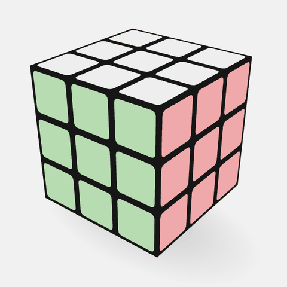
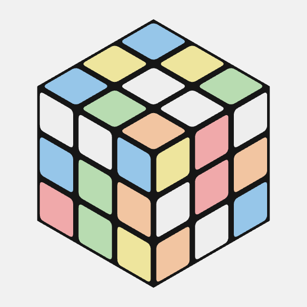
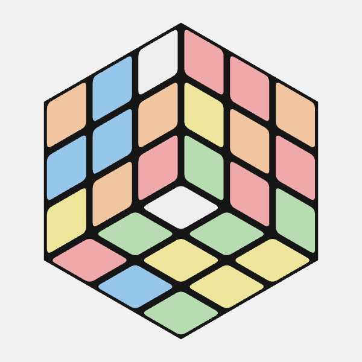
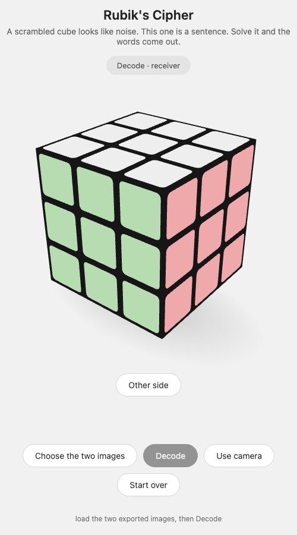
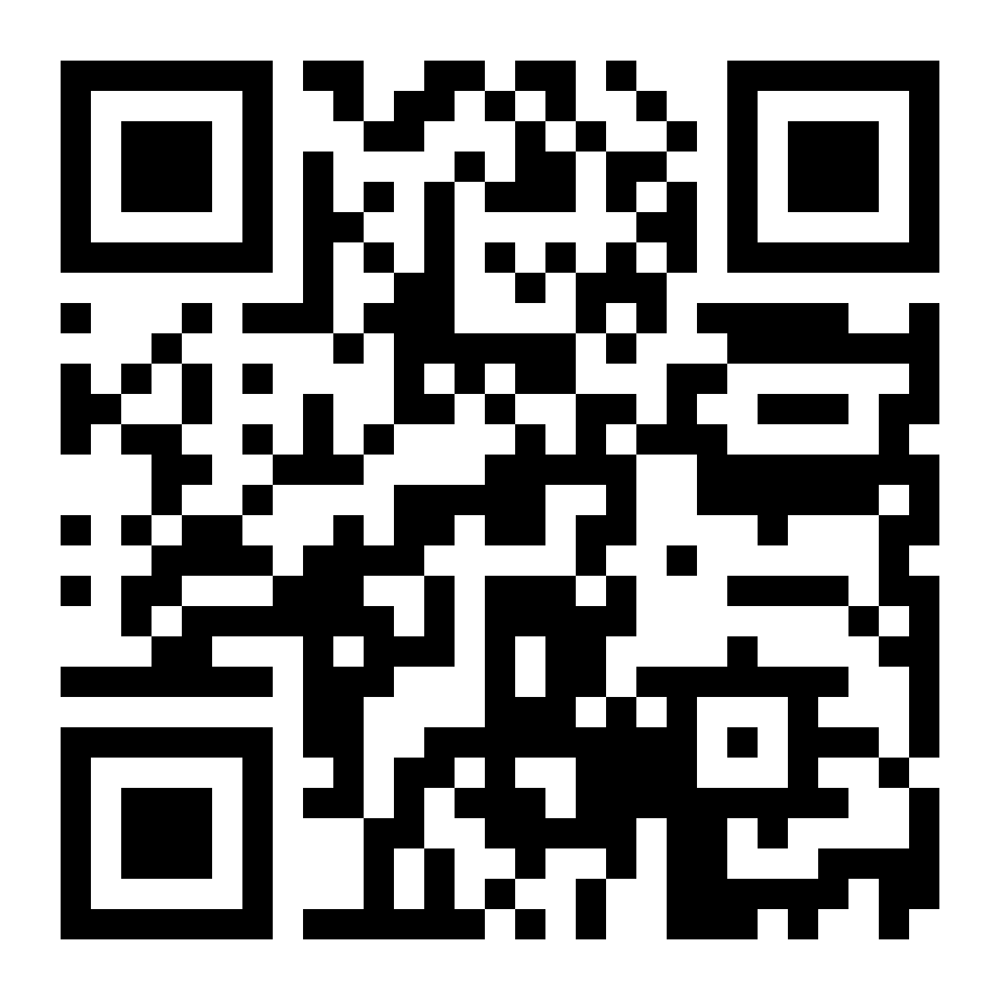

<h1 align="center">Rubik's Cipher</h1>

<p align="center"><strong>A scrambled cube looks like noise. This one is a sentence.</strong></p>

<p align="center">
  Three words go in. A Rubik's cube scramble comes out.<br>
  Anyone with two pictures of the cube can solve it and read the words back.
</p>

<p align="center">
  
</p>

<p align="center">
  <a href="https://rubiks-cipher-decode.onrender.com/">Live decoder</a> ·
  <a href="#how-it-works">How it works</a> ·
  <a href="#the-maths">The maths</a> ·
  <a href="#decode-with-a-phone-camera">Phone camera</a> ·
  <a href="#run-it">Run it</a>
</p>

> The message is not in the file name or the metadata. It exists only in how the stickers are arranged.

---

## What it does

**Encode.** Type three English words. The app turns them into one number, turns that number into one specific
arrangement of the 54 stickers, asks a solver how to solve that arrangement, and plays the solution backwards:
a scramble of about twenty moves, animated on a 3D cube you can drag around. Two renders from opposite corners
are exported; between them they show every sticker. Those two PNGs are the whole message.

**Decode.** Load the two PNGs, or point a phone at the encoder's screen. The stickers are read, checked against the
physical laws of the cube and a checksum, and converted back. The cube solves itself on screen and the three words
appear one by one as it does.

<p align="center">
  
  &nbsp;&nbsp;
  
</p>
<p align="center"><sub>The two exported images for <code>apple banana quokka</code>. Nothing else travels.</sub></p>

- Any of **371,272 English words**: the hackathon's 30,000-word list is the base (indices 0 to 29,999) and a
  370k-word dictionary fills in the rest. Each decoded word is tagged `list` or `dictionary`.
- A misread cube is **refused, not guessed**: a wrong sticker almost always breaks a cubie, the twist/flip/parity
  laws, or the 8 check bits.
- Works **fully offline**. The encoder and decoder are two separate sites, so the sender and receiver can be two
  computers that never share a network.

## How it works

```
three words ──▶ 3 × 19-bit indices = 57 bits ──▶ + 8 check bits (SHA-256) = 65-bit number
                                                              │
                        mixed-radix split over the legal cube states
                        corner order (8!) · corner twist (3^7) · edge flip (2^11) · edge order (12!/2)
                                                              │
                                                              ▼
                                      54 stickers ──▶ Kociemba two-phase solver ──▶ solution
                                                              │
                                              scramble = solution reversed and inverted
                                                              │
                                                              ▼
                      3D cube animates the scramble ──▶ two fixed-camera renders (A, B)

                      two renders ──▶ 54 sticker colours ──▶ cubies ──▶ cube laws ✓ ──▶ 65-bit number
                                      ──▶ check bits ✓ ──▶ 57 bits ──▶ three words ──▶ solve animation
```

The cube is treated as a counter. Dividing the 65-bit number by 40,320 gives which corner sits in each corner slot;
dividing what is left by 2,187 gives how each corner is twisted; by 2,048, which edges are flipped; and the remainder
says which edge sits in each edge slot, with its parity forced to match the corners. Each of those is unrolled into
pieces with a Lehmer code. Decoding is the same chain of multiplications in reverse, so the map is exactly invertible.

Reading the exported images is easy because the export camera is fixed: the decoder recomputes the same orthographic
projection and knows the pixel of every sticker centre. The six centre stickers never move on a cube, so their sampled
colours are the reference palette for everything else.

## The maths

| | |
| --- | --- |
| Legal cube states | 8! · 3^7 · 12!/2 · 2^11 = 43,252,003,274,489,856,000 ≈ 2^65.23 |
| Payload per cube | 57 data bits + 8 check bits = 65 bits |
| Words that fit | 3, each from a 371,272-word table (19 bits) |
| Scramble length | about 20 moves (Kociemba two-phase) |

Why not arbitrary text? 65 bits is about 13 letters of plain text, and three typical English words need ~100 bits even
with letter-frequency compression. A word table is what makes a word cost 19 bits instead of 30.

## Decode with a phone camera

<p align="center">
  
  &nbsp;&nbsp;&nbsp;
  
</p>

Open the live decoder on a phone, press **Use camera**, and photograph the encoder's laptop screen twice: the normal
view, then after pressing **Other side** on the encoder. A green outline and a "Cube detected" badge appear when the
cube is found, the shutter unlocks, and after the second photo the cube is read and solved on the phone.

This works because the encoder draws the cube with a camera we know exactly, so a photo of the screen is that known
picture seen through one homography. The decoder finds the cube's dark grid (black-hat filter), reduces its convex
hull to six corners, keeps only hexagons that enclose sticker-sized holes (so a laptop bezel never qualifies), and
tries both views and all six corner rotations, letting the centre-sticker colours pick the winner. The homography then
gives every sticker centre. On simulated phone photos (perspective, bezel, clutter, blur, noise, JPEG) it reads
20 of 20 exactly; HEIC uploads are accepted too.

## Run it

```bash
python -m venv .venv && .venv/bin/pip install -r requirements.txt
.venv/bin/python cube_encode_app.py            # sender    http://127.0.0.1:8771
.venv/bin/python cube_decode_app.py            # receiver  http://127.0.0.1:8772
.venv/bin/python cube_decode_app.py --https    # receiver with a self-signed cert, for phones on the same Wi-Fi
.venv/bin/python cube_app.py                   # dev: both tabs on http://127.0.0.1:8770
```

Deploy the decoder anywhere that runs a Dockerfile (Render config included; Hugging Face Spaces works unchanged on
port 7860). `CUBE_MODE=both` serves the encoder too.

```bash
.venv/bin/python test_cube.py                  # move tables agree with the solver, 65-bit round trips, illegal cubes refused
.venv/bin/python test_cube_vision.py           # synthetic renders -> stickers -> words
.venv/bin/python test_cube_screen.py front.png back.png FACELETS   # simulated phone photos of the screen
```

## Files

| file | role |
| --- | --- |
| `cube.py` | facelet geometry, move tables, facelets ↔ cubies, integer ↔ state, solver wrapper |
| `cube_codec.py` | tiered word table, words ↔ 57 bits ↔ 65-bit payload ↔ state |
| `cube_vision.py` | fixed-camera export projection, sticker sampling from the two renders |
| `cube_screen.py` | phone photos of the encoder screen: hexagon detection, homography, colour reading |
| `cube_app.py` | Flask app; `cube_encode_app.py` / `cube_decode_app.py` are the two sites; `wsgi.py` for hosting |
| `templates/cube.html`, `static/cube/cube.js` | Three.js cube, drag view, move animation, export, camera flow |
| `build_wordtable.py`, `extra_words.txt` | the dictionary minus the hackathon list |
| `CUBE.md` | the longer write-up of the method |

Made for DurHack 2026, the QRT "Hidden in Plain Sight" encoder challenge.
